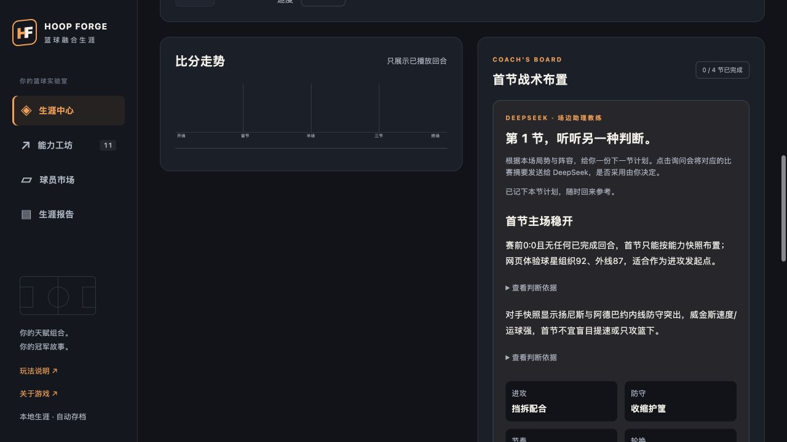

# 篮球融合生涯 · Hoop Forge

**把不同球星的天赋拼成一个人，他能夺冠吗？**

从20名NBA球员中，凭篮球知识盲选九张卡，各继承一项能力，创造自己的球星。选择30支球队之一，从首秀打到82场常规赛、附加赛与季后赛，用每一季的表现赚金币、抽卡和成长。

**[在线试玩 →](https://hoop-forge-play.artfulpika132.chatgpt.site)** · **[下载本地试玩包](https://github.com/aishilxw/hoop-forge/releases/tag/v0.3.4)**

在线版无需下载、登录或配置模型密钥；本地包需要Node.js 24。


## 快速开始

### 在线游玩

打开 **[在线试玩](https://hoop-forge-play.artfulpika132.chatgpt.site)**，点击“抽取我的20位球员”，选择九项能力、球队与姓名，确认后开启生涯。电脑和手机的现代浏览器均可访问；已检查响应式布局，未完成所有系统及真实手机设备兼容性测试。

存档保存在当前浏览器的 IndexedDB。换设备、换浏览器或从本地版迁移时，请使用“备份存档／导入存档”。清理浏览器数据会删除本地进度；没有账号与云存档同步。

### 本地运行源码

需要 **Node.js 24**（包含 npm）和现代浏览器。下载本仓库源码并解压，或 clone 后进入项目目录，在终端依次执行：

```sh
git clone https://github.com/aishilxw/hoop-forge.git
cd hoop-forge
npm ci
npm run build
npm run serve:local
```

如果已下载ZIP并解压到项目目录，可跳过git clone和cd。

打开 **[http://127.0.0.1:4178](http://127.0.0.1:4178)**，保持终端窗口开启。退出按 Ctrl+C。这组命令不需要填写模型密钥，启动脚本兼容 Windows/macOS/Linux 的 Node 环境；目前 macOS 已实测，Windows/Linux 尚未实机验证。

基础游戏资源随构建保存在本地，比赛模拟不调用模型。共享 AI 需要联网，并受下方额度与有效期限制。

### 本地开发与打包

```sh
# 前端热更新
npm run dev

# 检查
npm run typecheck
npm run lint
npm test
npm run validate:data

# 生成不需要 npm install 的试玩包
npm run build
npm run package:local
```

开发模式的前端会把 /api 转发到本机4178；需要 AI 时，在另一个终端运行 `npm run serve:local`。源码改动后重新构建，才能更新该本地服务的静态资源。

试玩包输出为 `release/hoop-forge-v0.3.4.zip`。解压后运行 `node start.mjs`，也可使用 macOS 的 start.command 或 Windows 的 start.bat。仍需 Node.js 24，但无需安装项目依赖。

## 玩法

- **九维盲选**：开局5张明星卡与15张其他球员卡。候选评分隐藏，九张不同的卡分别贡献内线得分、外线得分、内线防守、外线防守、组织、运球、速度、身体、篮板。确认签约后才揭晓能力。
- **完整NBA格式赛制**：30队，每队82场、41主41客；分区前6直入季后赛，7–10名附加赛，四轮七局四胜与2-2-1-1-1主场。
- **战术观战**：每季8场重点场，其他比赛也可主动观看。节间选择进攻、防守、节奏、轮换、个人上场预算与重点球员，影响下一节模拟。
- **回合可视化**：球场示意、投篮路线、比分走势和事件播报，支持暂停、单步、倍速与跳到节末。刷新后从已完成节继续。
- **持续生涯**：比赛获得金币，抽卡、继承能力、训练，经历年龄成长与衰退，也可主动退役。
- **AI生涯作者与教练**：报告基于已结算记录撰写，支持展开事实依据；教练只接收已完成节和阵容摘要，推荐下一节合法计划，是否采用由玩家决定。



## AI 与密钥

在线版和默认本地版连接同一共享服务，DeepSeek 模型密钥只保存在云端 Secret，**不在源码、浏览器资源或试玩包中**。本地服务仅转发固定的生涯报告与教练请求。

当前是小范围面试试玩额度：累计最多500次模型请求、每日100次、每份安装/浏览器每日30次；有效期至 **2026年11月29日13:19:53（北京时间）**。额度包含测试和失败预留，并非剩余500次。命中缓存不新增模型请求。到期、额度用尽或断网时仍可继续基础游戏和手动战术。

`scripts/release/review.config.json` 中的 buildId 是可公开、可撤销的试玩标识，**不是模型 API 密钥，也不是强身份认证**。下载者能提取它，全局持久配额是主要用量保护。不要把这个共享服务当作无限量公共模型接口。

如需使用自己的 DeepSeek 账户，复制 `scripts/release/.env.example` 为同目录的 `.env.local`，填写密钥并设为本地模式，然后重新启动。环境文件被 Git 忽略，不要提交或分享。详见 [AI配置说明](docs/ai-setup.md) 和 [安全说明](SECURITY.md)。

AI 仅在主动点击时请求。提示词、字段校验与缓存分别处理报告和教练，没有训练新的模型权重；AI 不参与决定比赛胜负。生成可能有解读偏差，精确数据以比赛统计为准。

## 技术与目录

Vue 3、TypeScript、Pinia、Vite、IndexedDB；比赛核心使用固定随机种子的纯函数，AI 与游戏结算分离。网页版通过 Sites / Vinext / Cloudflare Workers 托管，D1负责共享AI的持久计数和结果缓存。

```text
src/domain/          赛程、排名、季后赛、比赛模拟与生涯规则
src/application/     命令处理与IndexedDB存档
src/contracts/       共享类型与校验
src/ai/              已结算事实整理、浏览器AI缓存与请求
src/views/           开档、市场、比赛与生涯报告界面
scripts/release/     本地启动、AI服务与试玩包打包
tests/               游戏、存档及AI自动化检查
data/                名单来源快照与核验记录
deploy/web/          网页托管包装层与固定AI转发
deploy/shared-ai/    云端AI接口、配额、缓存与数据库迁移
docs/                规则、数据方法、教程与版本验收
```

部署目录是去除原站点身份和私有状态后的源码；不会自动修改现有在线站点。自行部署步骤见 [部署说明](docs/deployment.md)。

## 数据与验证范围

这是独立篮球模拟作品，与 NBA、NBA 2K 或球员本人无关联，不用于真实比赛预测。球队与球员名称、第三方数据及依赖素材的权利归各自权利人；来源见 [数据方法](docs/data-methodology.md) 与 [2K26映射说明](docs/2k26-mapping.md)。

当前冻结名单来自2026-10-29 RealGM逐队快照，共521人；与NBA官方聚合522人存在待定位差异，仍为 partial。446人映射2K26第三方归档，75人是明确标记的估计评分。赛程符合NBA对阵频次，非官方逐日赛程；后续赛季沿用冻结名单，没有未来真实交易或伤病系统。

游戏70项测试、云端配额5项测试和网页转发4项测试已通过；线上实测开档、首战结算、刷新恢复、AI教练和生涯故事。响应式预览不等于所有系统实机验收。历史验收与当前边界见 [验证记录](docs/qa/current-status.md)、[网页版验收](docs/qa/web-v034.md)。

[玩法教程](docs/tutorial.md) · [当前规则](docs/rules.md) · [AI优化评测](docs/qa/ai-v032.md) · [更新记录](CHANGELOG.md)
